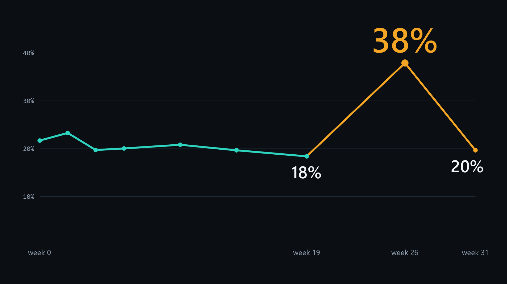

# HelpChoreAI

**A quality check for medical research measurements. Before anyone trusts a change, it asks if the change is real, noise, or a bad recording.**



- Live page: https://sain-muhammed-ali--helpchoreai-web.us-east.modal.run
- Video: VIDEO_URL

Hackathon theme: **Push the Frontier**, "accelerate a scientific experiment".

Research use only. Not medical advice. It diagnoses nothing and treats no one.

## Why I built this: VPS13A disease (Chorea-acanthocytosis)

**VPS13A disease (chorea-acanthocytosis)** is an ultra-rare, progressive, fatal brain disorder affecting roughly 1,000 people worldwide (Peikert et al., 2023). Loss-of-function mutations in the *VPS13A* gene remove chorein, a protein needed for lipid transport between cell membranes. Patients develop severe movement disorders (chorea, dystonia), seizures and cognitive decline, and there is **no approved treatment**.

Because lacking chorein also alters the red blood cell cytoskeleton, a large fraction of the patient's red blood cells become spiky (**acanthocytes**) (Lupo et al., 2016). Since researchers cannot biopsy the brain at every visit, small clinical studies ? such as experimental Lyn kinase inhibition with dasatinib or lithium (Peikert et al., 2021; Reichel et al., 2022)?follow only **3 to 5 patients** and measure the share of spiky red blood cells in high-speed microfluidic channels.

In a 5-patient study, **one noisy visit can look like a drug effect, or hide a real response** (Rabe et al., 2021). I originally applied to this hackathon to build drug-ranking agents for VPS13A disease. When I opened the real microfluidic recordings, I saw that nobody had audited the measurement itself. So I built **HelpChoreAI** first.

## What it tells a lab

HelpChoreAI answers three questions before anyone interprets a change:

1. Was the recording good enough?
2. Is the change bigger than the normal wobble of this measurement?
3. How many runs does the next visit need?

The statistics decide. AI does the looking, the writing and the checking. AI cannot change the numbers.

## Results

Data: Reichel et al. 2022, five patients. Three were used to build the method (dev). Two were sealed until the code and five predictions were frozen under git tag `eval-v1`.

| Finding | Number | Who |
|---|---|---|
| Faster flow, fewer spiky cells, in every visit | 37 of 37 visits | dev and sealed |
| Same effect on sealed patients | slope −0.32 in both (95% CI −0.36 to −0.28, and −0.37 to −0.27) | dev, sealed |
| A normal reading raises many alarms | 19 alarms in 32 visit pairs | dev and sealed |
| What the rule does with them | 5 confirmed, 4 ruled out, 10 refused | dev and sealed |
| A change the normal reading missed | 1 | dev |
| Smallest change this protocol can call | about 4 points (median band ±3.9) | dev and sealed |
| The tracker stores outlines that cannot show spikes | 2,673 of 2,673 cells fully convex | dev |
| Signed reports that verify on a fresh clone | 21 of 21 | dev |
| Tool checks stop wrong reports, scripted model | 9 signed with checks off, 0 with checks on | dev |
| Sentences that say more than the signed result | Muse Spark Open stopped 36 of 36 and passed 12 of 12 fair ones. A fixed word list stopped 3 | dev, sentences I wrote |
| Harder sentences | Muse Spark Open stopped 12 of 12 and passed 8 of 9 fair ones. The word list stopped 0 | dev, sentences I wrote |

<!--open-result-->
Open weights: 21 of 21 reports signed in open-weight mode carry the same numbers as the cloud run.

On baseten: advice hidden in normal words stopped 12 of 12 (fixed rules 0 of 12); clean reports passed 12 of 12.
<!--/open-result-->

## What did not work

- SAM shape gave little classifier gain on all cells (kappa 0.237 to 0.280) and none on sealed patients (0.033 to −0.052, 180 cells). An early gain of 0.28 to 0.37 existed only on a hard, selected subset.
- AI raters agree only weakly with the human on 100 random cells (AC1 0.345 for Muse Spark 1.3, 0.247 for Muse Spark Open).
- Muse Spark Open as a cell reader. It read all 1,944 cells for about $6, but its visit share did not follow the human one (within-patient correlation 0.29, error 12 points; limits fixed in advance were 0.5 and 8). So it does not read cells here. See [docs/OPEN_READER.md](docs/OPEN_READER.md).
- In video mode SAM kept cells in view, but spiky and smooth cells were no longer different in shape. So I track on video and measure on single frames.
- Five predictions were frozen before unsealing. One held fully, four missed at least in part. See the scorecards in [PREREGISTRATION.md](PREREGISTRATION.md) and [docs/POPULATION.md](docs/POPULATION.md).

## Validation status

Validation-ready, not validated: requirements, traceability and IQ/OQ/PQ drafts map to automated tests, with no independent approval. A second public RT-DC dataset serves as a positive control. See [docs/VALIDATION.md](docs/VALIDATION.md).

## Meta tools

| Tool | What it does here |
|---|---|
| SAM 3.1 | Draws the real cell edge from a box prompt (about 2,200 cached calls). Video tracking, with a position gate for identity lag |
| Muse Spark 1.3 | Audit agent with tool calling; second rater with an enforced schema (about 335 cached calls, plus agent turns) |
| Muse Spark Open | Open-weight agent, report auditor and claim checker, through OpenAI-compatible hosts (about 2,500 cached calls). Tested as a cell reader and rejected. See [docs/OPEN_WEIGHT.md](docs/OPEN_WEIGHT.md) and [docs/CLAIM_CHECK.md](docs/CLAIM_CHECK.md) |
| Muse Code (`muse-wonder-1.0`) | Wrote most of this repository |

## Built during the hackathon

All code in this repository was written during the event. First commit: 28 October 2026. See `git log`.

## Before the hackathon

- Third party: the Reichel et al. 2022 dataset and its tracker outputs, and the published papers I read.
- Mine: from 16 to 25 October I read papers, planned the work and explored the public dataset. Those notes, templates and scripts are not in this repository, and no file in it is identical to any of them.

## Try it on your own table

Any lab can run the same rule on its own run table. One command, no model, no key, nothing leaves your computer:

```bash
uv run python tools/audit_table.py examples/reichel2022_sealed_holdout.csv --reference 0.016
```

Use one row per run:

| Column | Meaning |
|---|---|
| `subject` | A code, never a name |
| `visit`, `visit_order` | Visit label, and a number that orders the visits |
| `run` | Run id inside the visit |
| `marked`, `rated`, `total` | Items with the marker, items that could be read, items seen |
| `disturbance` | A positive number that may disturb the measurement, such as flow or waiting time. Put 1 in every row if nothing was recorded |

It returns each visit pair with the normal reading, the corrected change, the normal wobble and the decision, plus the smallest change this protocol can call and an estimate of the runs needed.

`tests/test_audit_table.py` checks that it repeats all 32 decisions on this project's real dev and sealed holdout tables (`examples/reichel2022_sealed_holdout.csv`, Reichel et al. 2022 patients P3 and P5).

## Where else this could work

Built for one rare disease. The method fits any lab that measures the same sample many times, records what might disturb the measurement, and compares visits. Candidates: other blood cell shape tests, stored blood quality, imaging flow cytometry, manual cell counts.

None of these has been tested on real data. The −0.32 slope belongs to this device and this label. Each new setting needs its own calibration.

## Limits

- Five patients, one lab, one human rater.
- The label pools two kinds of spiky cell, acanthocytes and echinocytes.
- The false-alarm simulation (0.322 to 0.064) splits runs within one visit. It does not cover day-to-day variation.
- Power is 0.31 for a 5-point change and 0.77 for a 10-point change at current run counts.
- I measured that speed changes the reading, not why.
- Whether red cell shape tracks the disease in the brain is unknown. This makes the marker honest, not meaningful.

## Run it

```bash
git clone <this repository>
cd HelpChoreAI
uv sync
uv run pytest -q
```

Verify a signed report. No key needed, nothing is written:

```bash
uv run python -m src.agent verify P1_0w_2w
```

Open the page locally:

```bash
python -m http.server 8000 --directory web
```

The page replays signed results and calls no model. The local tool with sign-off runs with `uv run python src/server.py` on port 8765. Live model calls need keys in `.env` (see `.env.example`).

Raw data is not in the repository. `tools/figshare_ingest.py` fetches it from the public source.

## Scientific references

1. **Reichel, F. et al. (2022).** *Changes in blood cell deformability in chorea-acanthocytosis and effects of treatment with dasatinib or lithium.* **Frontiers in Physiology**, 13, 852946. [https://doi.org/10.3389/fphys.2022.852946](https://doi.org/10.3389/fphys.2022.852946) ? Dataset: Figshare Collection `5793482` ([https://doi.org/10.6084/m9.figshare.c.5793482](https://doi.org/10.6084/m9.figshare.c.5793482), CC BY 4.0).
2. **Peikert, K. et al. (2021).** *Therapeutic targeting of Lyn kinase to treat chorea-acanthocytosis.* **Acta Neuropathologica Communications**, 9, 81. [https://doi.org/10.1186/s40478-021-01181-y](https://doi.org/10.1186/s40478-021-01181-y).
3. **Lupo, F. et al. (2016).** *A new molecular link between defective autophagy and erythroid cell death in chorea-acanthocytosis.* **Blood**, 128(25), 2976?2987. [https://doi.org/10.1182/blood-2016-07-727321](https://doi.org/10.1182/blood-2016-07-727321).
4. **Rabe, A. et al. (2021).** *Staining for acanthocytes in neuroacanthocytosis syndromes: a step-by-step protocol and benchmark.* **Journal of Clinical Medicine**, 10(8), 1705. [https://doi.org/10.3390/jcm10081705](https://doi.org/10.3390/jcm10081705).
5. **Peikert, K., Hermann, A., & Danek, A. (2023).** *VPS13A Disease (Chorea-Acanthocytosis).* In **GeneReviews?** [Internet], University of Washington, Seattle. [https://www.ncbi.nlm.nih.gov/books/NBK1387/](https://www.ncbi.nlm.nih.gov/books/NBK1387/) (PMID: `20301549`).
6. **Urbanska, M. et al. (2020).** *A comparison of microfluidic methods for high-throughput cell deformability measurements.* **Nature Methods**, 17(6), 587?593. [https://doi.org/10.1038/s41592-020-0818-8](https://doi.org/10.1038/s41592-020-0818-8) ? Dataset: Figshare `11704119.v2` (CC0 1.0, positive control).
7. **Rosendahl, P. et al. (2018).** *Real-time fluorescence and deformability cytometry.* **Nature Methods**, 15(5), 355?358. [https://doi.org/10.1038/nmeth.4639](https://doi.org/10.1038/nmeth.4639).
8. **Mietke, A. et al. (2015).** *Extracting cell stiffness from real-time deformability cytometry: theory and experiment.* **Biophysical Journal**, 109(10), 2023?2036. [https://doi.org/10.1016/j.bpj.2015.09.006](https://doi.org/10.1016/j.bpj.2015.09.006).

## Licence and attribution

Code: MIT, see [LICENSE](LICENSE). Data: Reichel et al. 2022, Figshare Collection 5793482, CC BY 4.0. See [ATTRIBUTION.md](ATTRIBUTION.md).
